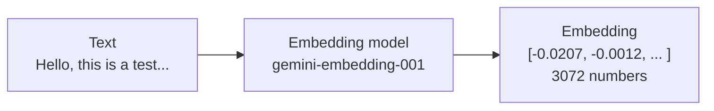
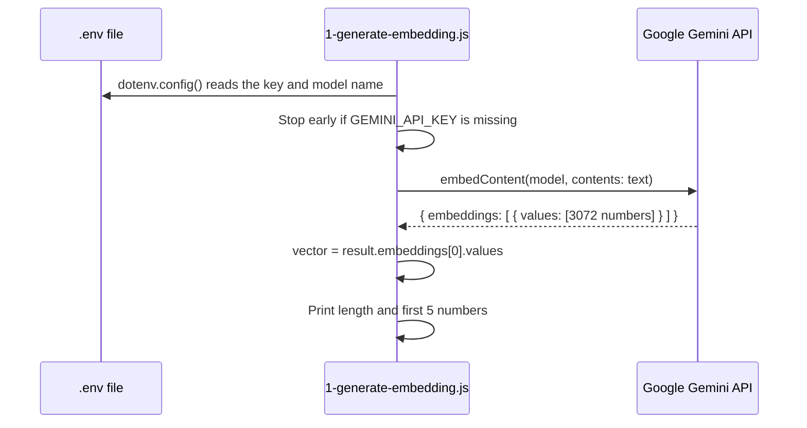
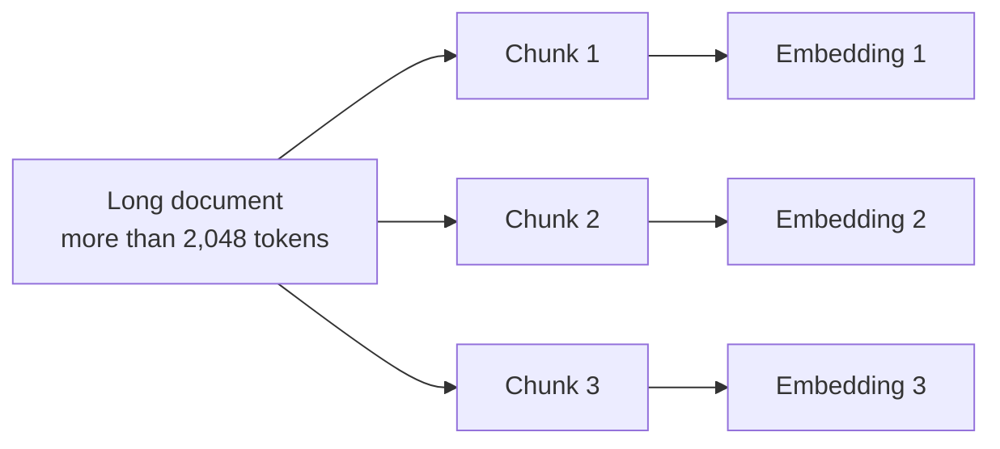
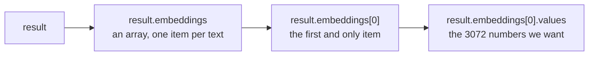
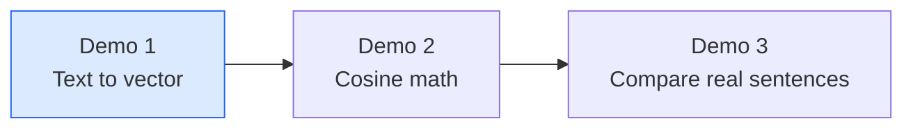

# Demo 1: Generate Your First Embedding

File: `1-generate-embedding.js`

In this demo you send one sentence to Google's embedding model and get back its **embedding**: a long list of numbers that represents the sentence's meaning.

| Class note section | Where you see it in this demo |
| --- | --- |
| 2. What Is an Embedding? | Text goes in, a 3072-number vector comes out |
| 2. How Text Becomes an Embedding | Text In → Embedding Model → Embedding Out |

### The big picture



### What the script does, step by step



---

## Run it

```bash
cd live-classes/week-3-demos
npm install            # only the first time
node 1-generate-embedding.js
```

Your `.env` file needs:

```env
GEMINI_API_KEY=your_api_key_here
GEMINI_EMBEDDING_MODEL=gemini-embedding-001
```

---

## Step 1: Import the tools

```js
import { GoogleGenAI } from '@google/genai';
import dotenv from 'dotenv';

dotenv.config();
```

- `@google/genai` is Google's official SDK. It's the same package we used in week 2 for chat.
- `dotenv` reads your `.env` file and puts its values into `process.env`.
- `dotenv.config()` must run **before** you read `process.env`, otherwise the values aren't loaded yet.

This project uses `import` instead of `require`, because `package.json` contains `"type": "module"`.

---

## Step 2: Read the settings

```js
const GEMINI_EMBEDDING_MODEL =
  process.env.GEMINI_EMBEDDING_MODEL || 'gemini-embedding-001';
const GEMINI_API_KEY = process.env.GEMINI_API_KEY;

if (!GEMINI_API_KEY) {
  throw new Error('GEMINI_API_KEY environment variable is required');
}
```

- The **model name** comes from `.env`, with `gemini-embedding-001` as a fallback (`||` means "use this if the left side is empty"). If Google retires the model, you change one line in `.env`, not your code.
- The **API key** must never be written in code. If it's missing, `throw new Error(...)` stops the script right away with a clear message.

> Notice the model is an **embedding** model, not a chat model like `gemma-4` from week 2. An embedding model never writes text. It only turns text into numbers.

---

## Step 3: Create the client

```js
// 1. Initialize the SDK
const ai = new GoogleGenAI({ apiKey: GEMINI_API_KEY });
```

`ai` is your connection to Google's API. Every request in this file goes through it.

---

## Step 4: Generate the embedding

```js
async function generateEmbedding() {
  // gemini-embedding-001 accepts up to 2,048 tokens per text.
  // Longer documents must be split into smaller chunks first (week 4).
  const text = 'Hello, this is a test for vector embeddings.';

  try {
    // 2. Generate the embedding
    const result = await ai.models.embedContent({
      model: GEMINI_EMBEDDING_MODEL,
      contents: text,
    });
```

- `async` / `await`: the request travels over the internet, so we wait for the answer before continuing.
- `ai.models.embedContent(...)` is the embedding API. In week 2 we used `generateContent`, which returns text. `embedContent` returns numbers.
- `contents: text` is the text we want to turn into a vector.
- **There's a size limit.** `gemini-embedding-001` accepts up to **2,048 tokens** (roughly 1,500 words) per text. A long document must first be split into smaller pieces called **chunks**, and each chunk gets its own embedding. One vector for a whole book would blur its meaning anyway. You'll do this in week 4.



---

## Step 5: Read the vector from the response

```js
    const vector = result.embeddings[0].values;
```

The response looks like this (shortened):

```js
{
  embeddings: [
    { values: [-0.0207, -0.0012, -0.0081, -0.0750, -0.0108, /* ... 3067 more */] }
  ]
}
```



- `embeddings` is an **array**, because you can send several texts in one request (demo 3 does that).
- We sent one text, so we take the first item: `embeddings[0]`.
- `.values` is the actual list of numbers.

---

## Step 6: Print the result

```js
    console.log(`Text: "${text}"`);
    console.log(`Vector Length (Dimensions): ${vector.length}`);
    console.log(`First 5 numbers:`, vector.slice(0, 5));
```

- `vector.length` is the number of **dimensions**: how many numbers describe the text.
- `vector.slice(0, 5)` shows only the first 5 numbers. Printing all 3072 would fill your terminal.

---

## Step 7: Handle errors

```js
  } catch (error) {
    console.error('Error:', error.message);
  }
}

generateEmbedding();
```

A wrong API key, no internet or a rate limit (`429`) ends up here with a readable message. The last line actually runs the function.

---

## Expected output

```text
Text: "Hello, this is a test for vector embeddings."
Vector Length (Dimensions): 3072
First 5 numbers: [ -0.02065937, -0.0012461969, -0.008109019, -0.07498348, -0.010818116 ]
```

### Reading the output

- **3072 numbers** describe one short sentence. The class note's 2D examples used 2 numbers; real models use thousands.
- **You can't read meaning from a single number.** Number 1 doesn't mean "is a greeting" or anything else a human can name. The dimensions are *latent*: the model learned them on its own.
- **The same text with the same model gives the same numbers every time.** That's why you can save embeddings and compare them later.
- The vector only means something when you **compare** it with another vector from the same model. That's demos 2 and 3.

---

## Try it yourself

1. **Change "Hello" to "Hi".** Run it again. Are the first 5 numbers the same? Close? (They change only a little.)
2. **Change the whole sentence to "Banana".** How different are the numbers now? Is the length still 3072?
3. **A smaller vector.** Add a `config` to the request and check the length:

   ```js
   const result = await ai.models.embedContent({
     model: GEMINI_EMBEDDING_MODEL,
     contents: text,
     config: { outputDimensionality: 768 },
   });
   ```

   Smaller vectors take less storage. The class note mentions 768 and 1536 as common sizes.
4. **Measure the vector's length** (its *magnitude*). Add:

   ```js
   const magnitude = Math.sqrt(vector.reduce((sum, n) => sum + n * n, 0));
   console.log('Magnitude:', magnitude.toFixed(4));
   ```

   Try it with the default size, then with `outputDimensionality: 768`. What do you notice?

   **Answer:** the full 3072-number vector has a length of exactly **1**. Google *normalizes* it. At 768 numbers the length drops to about **0.58**, because `gemini-embedding-001` only normalizes the full-size vector. Google's documentation says to normalize shorter vectors yourself, by dividing every number by the length:

   ```js
   const magnitude = Math.sqrt(vector.reduce((sum, n) => sum + n * n, 0));
   const normalized = vector.map(n => n / magnitude);
   // normalized now has a length of exactly 1
   ```

   Why bother? Cosine similarity divides by the lengths anyway, so its scores don't change. But some vector databases score with a plain **dot product** to save time, and that gives wrong results if the vectors aren't length 1. (The newer `gemini-embedding-2` normalizes shorter vectors automatically.)

   ```mermaid
   flowchart LR
       F["3072 numbers<br/>length 1.00"] -->|"outputDimensionality: 768"| S["768 numbers<br/>length about 0.58"]
       S -->|"divide each number by the length"| N["768 numbers<br/>length 1.00"]
   ```

Where this demo fits in the week:



Eyeballing numbers only gets you so far. To *measure* how close "Hello" and "Hi" are, you need cosine similarity: demo 2.

---

## Key takeaways

- An **embedding** is a list of numbers that represents the meaning of text.
- `embedContent` returns numbers; `generateContent` returns text. They are different models and different APIs.
- `gemini-embedding-001` returns **3072** numbers by default, and you can ask for fewer.
- A single embedding means nothing on its own. Its value comes from comparing it with other embeddings from the **same model**.
