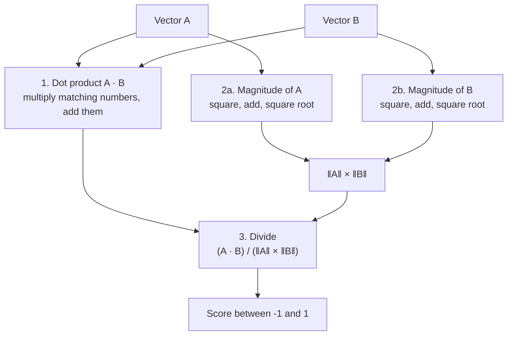
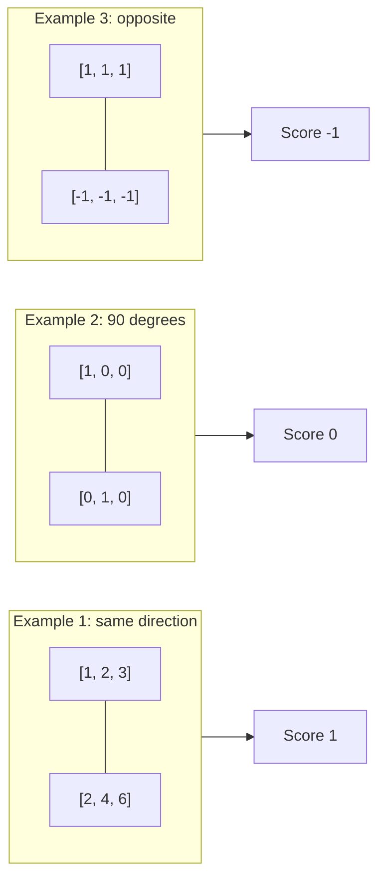
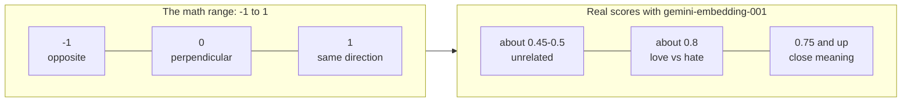

# Demo 2: The Math of Similarity (Cosine Similarity)

File: `2-math-similarity.js`

In this demo you write cosine similarity yourself and test it on three tiny, hand-made vectors. There's no API call and no API key: just JavaScript and math.

| Class note section | Where you see it in this demo |
| --- | --- |
| 3. Measuring Similarity | The formula `(A · B) / (‖A‖ × ‖B‖)` |
| 3. The Algorithm (Step-by-Step) | Dot product → magnitudes → divide |
| 3. How to Read the Score | 1, 0 and -1 |

---

## Run it

```bash
cd live-classes/week-3-demos
node 2-math-similarity.js
```

No `.env` needed. This demo never talks to Google.

---

## The idea in one sentence

Cosine similarity measures whether two vectors **point the same way**:

| Direction | Score |
| --- | --- |
| Same direction | `1` |
| At 90° (perpendicular) | `0` |
| Exactly opposite | `-1` |

It ignores how **long** the vectors are. Only direction counts.

### The algorithm



### The three test cases



---

## Step 1: The dot product (`A · B`)

```js
function cosineSimilarity(vecA, vecB) {
  // 1. Dot Product (multiply matching components and sum)
  let dotProduct = 0;
  for (let i = 0; i < vecA.length; i++) {
    dotProduct += vecA[i] * vecB[i];
  }
```

Multiply the numbers in the same position, then add everything up.

For `A = [1, 2, 3]` and `B = [2, 4, 6]`:

```text
A · B = (1 × 2) + (2 × 4) + (3 × 6)
      =    2    +    8    +   18
      = 28
```

`+=` means "add to what's already there", so after the loop `dotProduct` holds the total.

---

## Step 2: The magnitudes (`‖A‖` and `‖B‖`)

```js
  // 2. Magnitude (Length of each vector)
  let magnitudeA = 0;
  let magnitudeB = 0;

  for (let i = 0; i < vecA.length; i++) {
    magnitudeA += vecA[i] * vecA[i];
  }
  magnitudeA = Math.sqrt(magnitudeA);

  for (let i = 0; i < vecB.length; i++) {
    magnitudeB += vecB[i] * vecB[i];
  }
  magnitudeB = Math.sqrt(magnitudeB);
```

The **magnitude** is the length of the arrow. Square each number, add them, then take the square root (this is Pythagoras' theorem in more dimensions):

```text
‖A‖ = √(1² + 2² + 3²) = √(1 + 4 + 9)   = √14 ≈ 3.742
‖B‖ = √(2² + 4² + 6²) = √(4 + 16 + 36) = √56 ≈ 7.483
```

B is exactly twice as long as A, because every number in B is doubled.

---

## Step 3: Divide

```js
  // 3. Formula: (A . B) / (||A|| * ||B||)
  if (magnitudeA === 0 || magnitudeB === 0) return 0; // Avoid division by zero
  return dotProduct / (magnitudeA * magnitudeB);
}
```

```text
cosine = 28 / (3.742 × 7.483)
       = 28 / 28
       = 1
```

Dividing by the two lengths is what removes the effect of length. That's why B being twice as long doesn't matter.

The `if` line protects against a vector of all zeros (length 0). Dividing by zero would give `NaN`, so we return `0` instead.

---

## Step 4: The three test cases

### Example 1: Same direction

```js
const vector1 = [1, 2, 3];
const vector2 = [2, 4, 6]; // Same direction, just longer
console.log('Similarity (Identical):', cosineSimilarity(vector1, vector2).toFixed(4)); // 1.0000
```

`vector2` is `vector1 × 2`. Same direction, different length → **1**. This is the same idea as "Big" `[5, 1]` and "Huge" `[10, 2]` in the class note.

### Example 2: Perpendicular

```js
const vector3 = [1, 0, 0]; // Points along X-axis
const vector4 = [0, 1, 0]; // Points along Y-axis
console.log('Similarity (Orthogonal):', cosineSimilarity(vector3, vector4).toFixed(4)); // 0.0000
```

One arrow points along the X-axis, the other along the Y-axis: a 90° angle. The dot product is `(1×0) + (0×1) + (0×0) = 0`, so the score is **0**.

### Example 3: Opposite

```js
const vector5 = [1, 1, 1];
const vector6 = [-1, -1, -1];
console.log('Similarity (Opposite):', cosineSimilarity(vector5, vector6).toFixed(4)); // -1.0000
```

Every number is flipped, so the arrows point in exactly opposite directions → **-1**.

### Why `.toFixed(4)`?

Computers store decimals approximately. Without rounding, Example 3 prints `-1.0000000000000002` instead of `-1`. `.toFixed(4)` rounds to 4 decimal places so the output is clean. (It also turns the number into a string, which is fine for printing.)

---

## Expected output

```text
Similarity (Identical): 1.0000
Similarity (Orthogonal): 0.0000
Similarity (Opposite): -1.0000
```

---

## Important: real embeddings don't use this full range

These vectors were hand-made to show the **mathematical** range, from -1 to 1. Real embedding models use a much smaller part of it:



With `gemini-embedding-001`:

| Texts | Real score |
| --- | --- |
| Very close meaning | about 0.75 and up |
| Completely unrelated | about 0.45–0.5 (not 0) |
| Opposite meaning ("I love coding" vs "I hate coding") | about **0.80** (not -1) |

Two lessons from this:

- **Unrelated isn't 0.** Compare scores with each other instead of reading them as fixed meanings.
- **Opposite meaning isn't opposite direction.** Embeddings measure what a text is *about*. "I love coding" and "I hate coding" are both about feelings towards coding, so they point in a similar direction.

The comments at the top of `2-math-similarity.js` describe the maths ("-1 = opposite"). Remember that in the real world, "opposite direction" almost never happens.

---

## Try it yourself

1. **Do Example 1 by hand.** Use the steps above with paper and a calculator before running the code. Do you get 28, 3.742, 7.483 and 1?
2. **Use the class note's vectors.** Add "Big" `[5, 1]` and "Long" `[1, 5]`:

   ```js
   console.log('Big vs Long:', cosineSimilarity([5, 1], [1, 5]).toFixed(4));
   ```

   The class note calculated about 0.38. Do you get the same?
3. **Length doesn't matter.** Compare `[1, 2, 3]` with `[100, 200, 300]`. What's the score? Why?
4. **Remove `.toFixed(4)`** from Example 3 and run it again. What do you see?
5. **Try a zero vector.** What does `cosineSimilarity([0, 0, 0], [1, 2, 3])` return? Which line of code decided that?

---

## Key takeaways

- Cosine similarity = **dot product ÷ (length of A × length of B)**.
- It compares **direction** only. Doubling a vector doesn't change the score.
- The maths range is -1 to 1, but real embeddings mostly score between about 0.4 and 0.9.
- In demo 3 we run this exact function on real 3072-number embeddings.
