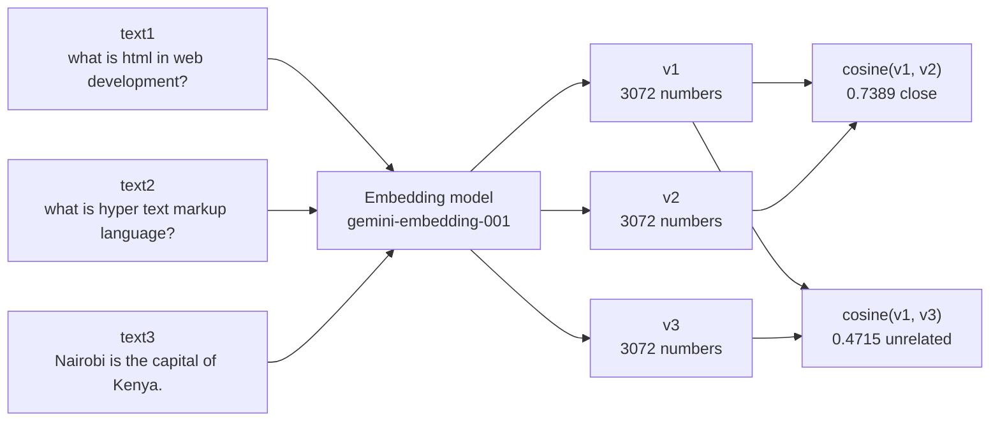
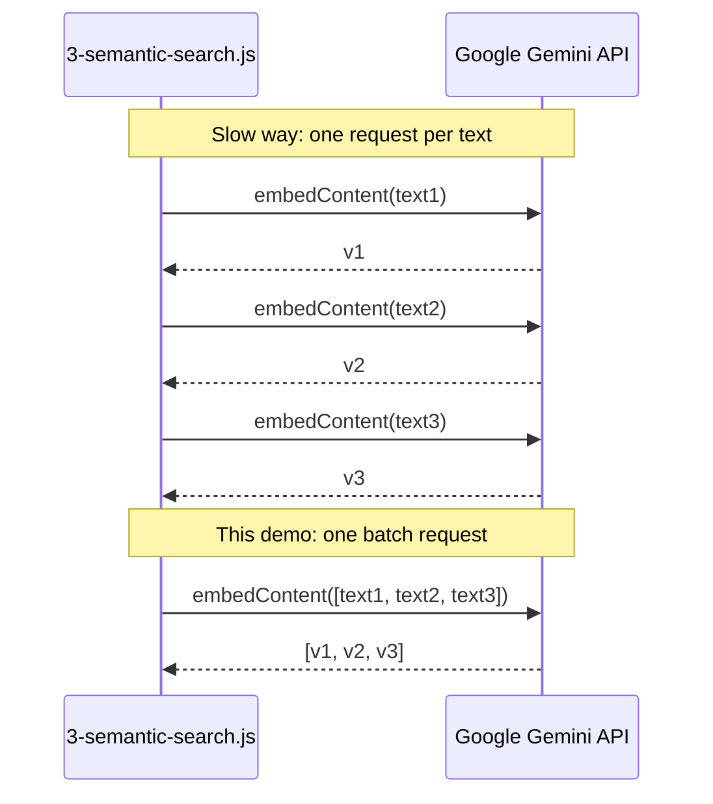
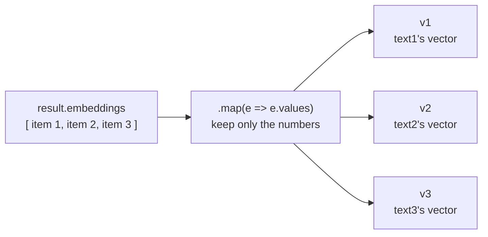
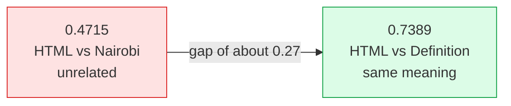
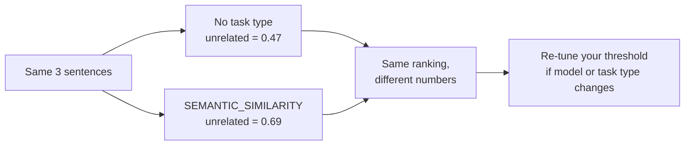
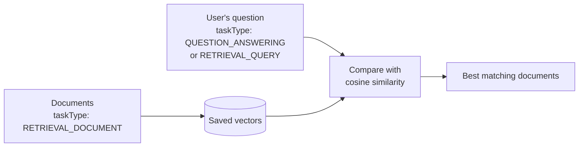

# Demo 3: Comparing Meanings with Real Embeddings

File: `3-semantic-search.js`

This demo combines demos 1 and 2. It turns three real sentences into embeddings (demo 1), then measures how close their meanings are with cosine similarity (demo 2).

| Class note section | Where you see it in this demo |
| --- | --- |
| 1. The Solution: Semantic Search | Two sentences with different words but the same meaning score high |
| 2. What Is an Embedding? | Each sentence becomes a 3072-number vector |
| 3. Measuring Similarity | Cosine similarity on real vectors, and how to read the score |

### The big picture



---

## Run it

```bash
cd live-classes/week-3-demos
node 3-semantic-search.js
```

Your `.env` file needs:

```env
GEMINI_API_KEY=your_api_key_here
GEMINI_EMBEDDING_MODEL=gemini-embedding-001
```

---

## Step 1: Setup

```js
import { GoogleGenAI } from '@google/genai';
import dotenv from 'dotenv';

dotenv.config();

const GEMINI_EMBEDDING_MODEL =
  process.env.GEMINI_EMBEDDING_MODEL || 'gemini-embedding-001';
const GEMINI_API_KEY = process.env.GEMINI_API_KEY;

if (!GEMINI_API_KEY) {
  throw new Error('GEMINI_API_KEY environment variable is required');
}

// Initialize with your API Key
const ai = new GoogleGenAI({ apiKey: GEMINI_API_KEY });
```

This is the same setup as demo 1: load `.env`, read the model name and key, stop early if the key is missing, and create the client. See `1-generate-embedding.md` for the details.

---

## Step 2: Cosine similarity (shorter version)

```js
/**
 * Calculates Cosine Similarity between two vectors.
 * The math range is -1 to 1, but real embeddings use much less of it:
 * with gemini-embedding-001, unrelated text scores about 0.4-0.5 and close
 * matches about 0.75 and up. Compare scores with each other, not with 0.
 */
function cosineSimilarity(vecA, vecB) {
  let dotProduct = 0;
  let magnitudeA = 0;
  let magnitudeB = 0;

  for (let i = 0; i < vecA.length; i++) {
    dotProduct += vecA[i] * vecB[i];
    magnitudeA += vecA[i] * vecA[i];
    magnitudeB += vecB[i] * vecB[i];
  }

  magnitudeA = Math.sqrt(magnitudeA);
  magnitudeB = Math.sqrt(magnitudeB);

  if (magnitudeA === 0 || magnitudeB === 0) return 0;
  return dotProduct / (magnitudeA * magnitudeB);
}
```

This does exactly the same maths as demo 2, but in **one** loop instead of three. In each round of the loop it adds to all three running totals at once:

| Variable | What it collects | Formula part |
| --- | --- | --- |
| `dotProduct` | `A[i] × B[i]` | `A · B` |
| `magnitudeA` | `A[i]²` (square root taken after the loop) | `‖A‖` |
| `magnitudeB` | `B[i]²` (square root taken after the loop) | `‖B‖` |

One loop is faster: each vector has 3072 numbers, so the old version walked through them three times.

---

## Step 3: The three sentences

```js
async function compareTexts() {
  const text1 = 'what is html in web development?';
  const text2 = 'what is hyper text markup language?';
  const text3 = 'Nairobi is the capital of Kenya.';
```

They were chosen on purpose:

- `text1` and `text2` mean the same thing (HTML **is** HyperText Markup Language), but they share almost no words. A keyword search for "html" would never find `text2`.
- `text3` is about something completely different: a control.

```js
  console.log('Comparing texts:');
  console.log(`1. "${text1}"`);
  console.log(`2. "${text2}"`);
  console.log(`3. "${text3}"`);
```

---

## Step 4: Turn all three sentences into embeddings (one request)

```js
  try {
    // Generate all three embeddings in ONE request by passing an array.
    // The response has one embedding per text, in the same order.
    const result = await ai.models.embedContent({
      model: GEMINI_EMBEDDING_MODEL,
      contents: [text1, text2, text3],
      // Experiment: uncomment the next line and run again.
      // Every score goes up (unrelated text jumps from about 0.47 to about 0.69),
      // because a task type changes how the model places the texts.
      // config: { taskType: 'SEMANTIC_SIMILARITY' },
    });
```

This is demo 1's `embedContent` call, but `contents` is now an **array** of three texts instead of one string. Google returns one embedding per text, in the same order, all in a single request.

- **Why one request?** Three separate requests would be slower and use three times as much of your rate limit. Google's own documentation uses this pattern.
- **All three use the same model.** That's required: each embedding model builds its own "map" of meaning, so vectors from different models can't be compared (class note, section 2).
- **The commented-out `config` line** is an experiment for later. See "Task types" below.



---

## Step 5: Pull out the vectors

```js
    const [v1, v2, v3] = result.embeddings.map(embedding => embedding.values);
```

Read it from right to left:

1. `result.embeddings` is an array with three items, one per text.
2. `.map(embedding => embedding.values)` keeps only the 3072 numbers from each item.
3. `const [v1, v2, v3] = ...` is **array destructuring**: it puts the first vector in `v1`, the second in `v2` and the third in `v3`.



---

## Step 6: Compare and print

```js
    // Compare similarity
    const similarity12 = cosineSimilarity(v1, v2); // HTML vs Definition
    const similarity13 = cosineSimilarity(v1, v3); // HTML vs Nairobi

    console.log(`\nSimilarity (HTML vs Definition): ${similarity12.toFixed(4)}`);
    console.log(`Similarity (HTML vs Nairobi):    ${similarity13.toFixed(4)}`);
  } catch (error) {
    console.error('Error comparing texts:', error.message);
  }
}

compareTexts();
```

- We compare `text1` with each of the others.
- `.toFixed(4)` rounds to 4 decimal places, as in demo 2.
- `catch` prints a readable message for a wrong key, no internet or a rate limit.

---

## Expected output

```text
Comparing texts:
1. "what is html in web development?"
2. "what is hyper text markup language?"
3. "Nairobi is the capital of Kenya."

Similarity (HTML vs Definition): 0.7389
Similarity (HTML vs Nairobi):    0.4715
```

### Reading the scores

- **0.7389:** the two HTML sentences are close in meaning, even though they share almost no words. Keyword search can't do this.
- **0.4715:** HTML and Nairobi are unrelated. Notice it's **not** close to 0, even though demo 2 said "unrelated = 0".
  - That's normal for real embedding models. With this model, completely unrelated text usually scores about 0.45–0.5.
  - So don't read 0.47 as "47% related". It means "about as unrelated as text gets with this model".
- **The gap is what matters:** 0.74 against 0.47. Always compare scores with each other.



---

## Task types: telling the model what the embedding is for

`gemini-embedding-001` accepts an optional **task type**. It tells the model what you'll use the embedding for, so it can place the text in a way that suits that job:

```js
config: { taskType: 'SEMANTIC_SIMILARITY' },
```

| Task type | Use it for | Example |
| --- | --- | --- |
| `SEMANTIC_SIMILARITY` | Comparing two texts | This demo; duplicate-question detection |
| `RETRIEVAL_DOCUMENT` | Documents you will store and search | Forum posts, course pages |
| `RETRIEVAL_QUERY` | The user's search text | A search box |
| `QUESTION_ANSWERING` | A chatbot's question | "How long is the course?" |
| `CLASSIFICATION` | Sorting text into labels | Spam / not spam |
| `CLUSTERING` | Grouping similar texts | Finding common topics |

### What a task type does to the scores

We ran this demo with and without `SEMANTIC_SIMILARITY`:

| | HTML vs Definition | HTML vs Nairobi | Gap |
| --- | --- | --- | --- |
| No task type (this demo) | 0.7389 | 0.4715 | 0.27 |
| `SEMANTIC_SIMILARITY` | 0.9351 | **0.6941** | 0.24 |

**Every** score went up, even the unrelated one. The ranking stayed the same, but the numbers changed a lot. So:

- **A threshold only works for the exact model and task type you tuned it on.** A cutoff of 0.6 would hide Nairobi without a task type, but show it with one.
- **Never compare embeddings made with different task types.** Treat them like different models.



### Preview for week 4: search uses two task types

In a search or chatbot, documents and questions use **different but matching** task types:



Next week's RAG demo uses exactly this pair.

> **`gemini-embedding-2` works differently.** Google's newer model doesn't accept `taskType`. You write the task into the text instead, e.g. `'task: sentence similarity | query: what is html?'`. It's also a separate "map" of meaning, so we keep `gemini-embedding-001` for the whole course.

---

## Try it yourself

1. **A related but different topic.** Change `text2` to `'what is CSS in web development?'`. Is it closer to `text1` than Nairobi? Is it as close as the HTML definition was?
2. **Opposite meaning.** Compare `'I love coding'` with `'I hate coding'`. Do you get a low score or a high one? Why? (Class note, section 3: embeddings measure what a text is *about*.)
3. **Compare all pairs.** Add a third comparison, `text2` vs `text3`. Is it also around 0.47?
4. **Turn on the task type.** Uncomment `config: { taskType: 'SEMANTIC_SIMILARITY' },` and run again. Do both scores go up? Does the order change? What would happen to a search that hides everything below 0.6?
5. **Make it a search.** Add five more sentences, compare `text1` with each, and sort the results from highest to lowest. You've just built a tiny search engine: that's ranking.

---

## Key takeaways

- Sentences with the **same meaning** score high even with **different words**. That's semantic search's advantage over keyword search.
- Real scores sit in a narrow range: here 0.74 for close and 0.47 for unrelated. Read scores **relative to each other**.
- Always embed everything with the **same model** and the **same task type**.
- Scores depend on both. Tune thresholds for the exact setup you use.
- Send many texts in **one** request with an array.
- Comparing pairs is the building block. A real search compares a question with many documents, sorts them by score (ranking) and hides weak matches (a threshold).
